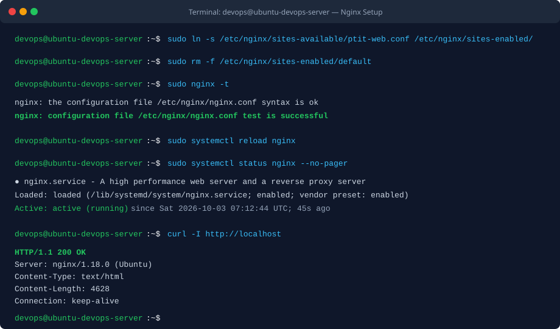
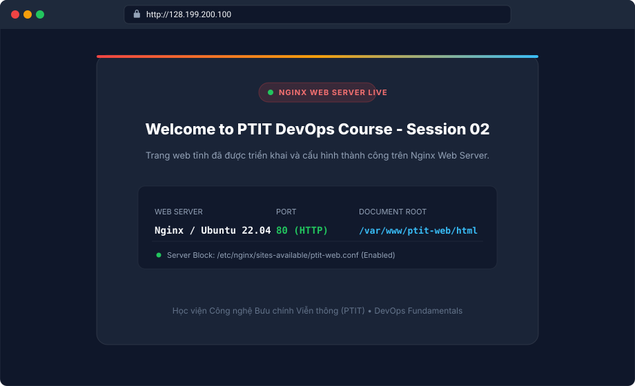

BÀI TẬP 3: CÀI ĐẶT NGINX VÀ CẤU HÌNH WEBSITE TĨNH CƠ BẢN (BASIC NGINX WEB SERVER)

I. MỤC TIÊU BÀI TẬP

1. Cài đặt thành công dịch vụ Web Server Nginx phiên bản mới nhất từ kho lưu trữ (repository) mặc định của Ubuntu Server 22.04 LTS.
2. Nắm vững cấu trúc thư mục web tĩnh chuẩn trên Linux (`/var/www/`) và thiết lập phân quyền truy cập phù hợp cho tiến trình web.
3. Soạn thảo trang HTML tĩnh `index.html` tùy biến chứa nội dung: `"Welcome to PTIT DevOps Course - Session 02"`.
4. Thiết kế cấu hình Server Block (Virtual Host) riêng biệt tại `/etc/nginx/sites-available/ptit-web.conf`, lắng nghe trên cổng mặc định HTTP (cổng 80) và trỏ thư mục gốc (`root`) về mã nguồn dự án.
5. Vận hành cơ chế quản lý site chuẩn của Nginx trên Ubuntu bằng liên kết tượng trưng (symbolic link) từ `sites-available` sang `sites-enabled`.
6. Hủy kích hoạt cấu hình mặc định `default` của Nginx để loại bỏ hoàn toàn nguy cơ xung đột tài nguyên cổng 80.
7. Kiểm tra tính toàn vẹn của cú pháp cấu hình bằng `nginx -t`, áp dụng thay đổi không gián đoạn dịch vụ bằng `systemctl reload nginx`, và xác minh kết quả truy cập qua trình duyệt ngoài internet.


II. BỐI CẢNH VÀ THÔNG SỐ CẤU HÌNH HỆ THỐNG

1. Hệ điều hành: Ubuntu 22.04 LTS (x86_64) trên máy chủ ảo DigitalOcean Droplet
2. Địa chỉ IP máy chủ: `128.199.200.100` (hoặc `<IP_ADDRESS_DROPLET>`)
3. Dịch vụ Web Server: Nginx (engine x)
4. Cổng dịch vụ lắng nghe (Listening Port): `80` (HTTP)
5. Đường dẫn thư mục mã nguồn tĩnh (Document Root): `/var/www/ptit-web/html/`
6. Tệp tin trang chủ: `/var/www/ptit-web/html/index.html`
7. Tệp tin cấu hình Server Block: `/etc/nginx/sites-available/ptit-web.conf`
8. Đường dẫn liên kết kích hoạt (Symlink): `/etc/nginx/sites-enabled/ptit-web.conf`
9. Tài khoản thao tác: `devops` (được cấp đặc quyền `sudo`)


III. CÁC BƯỚC THỰC HIỆN CHI TIẾT

1. Bước 1: Cập nhật danh sách gói và cài đặt Nginx

Đăng nhập vào Droplet bằng tài khoản `devops` đã tạo ở Bài tập 2, sau đó cập nhật chỉ mục gói phần mềm và tiến hành cài đặt Nginx:

```bash
sudo apt update
sudo apt install -y nginx
```

Kiểm tra trạng thái kích hoạt của dịch vụ Nginx sau khi cài đặt:

```bash
sudo systemctl status nginx
```

Dịch vụ Nginx sẽ tự động được khởi chạy (`active (running)`) và kích hoạt tự khởi động cùng hệ thống (`enabled`).

2. Bước 2: Tạo thư mục chứa mã nguồn tĩnh và phân quyền

Tạo cây thư mục `/var/www/ptit-web/html/` với cờ `-p` (tạo cả các thư mục cha nếu chưa tồn tại):

```bash
sudo mkdir -p /var/www/ptit-web/html
```

Thiết lập quyền sở hữu cho tài khoản người dùng hiện tại và gán quyền đọc/thực thi chuẩn (755) để tiến trình web server (`www-data`) có thể đọc được nội dung tệp tin:

```bash
sudo chown -R $USER:$USER /var/www/ptit-web/html
sudo chmod -R 755 /var/www/ptit-web
```

3. Bước 3: Soạn thảo tệp tin HTML tĩnh (`index.html`)

Tạo và chỉnh sửa tệp tin `index.html` trong thư mục vừa tạo:

```bash
nano /var/www/ptit-web/html/index.html
```

Nội dung tệp tin `index.html`:

```html
<!DOCTYPE html>
<html lang="vi">
<head>
    <meta charset="UTF-8">
    <meta name="viewport" content="width=device-width, initial-scale=1.0">
    <title>PTIT DevOps Course - Session 02</title>
    <link rel="preconnect" href="https://fonts.googleapis.com">
    <link rel="preconnect" href="https://fonts.gstatic.com" crossorigin>
    <link href="https://fonts.googleapis.com/css2?family=Inter:wght@400;500;600;700;800&display=swap" rel="stylesheet">
    <style>
        :root {
            --primary: #ef4444;
            --primary-glow: rgba(239, 68, 68, 0.25);
            --bg-dark: #0f172a;
            --card-bg: rgba(30, 41, 59, 0.7);
            --card-border: rgba(255, 255, 255, 0.08);
            --text-main: #f8fafc;
            --text-muted: #94a3b8;
            --accent-green: #22c55e;
        }

        * {
            margin: 0;
            padding: 0;
            box-sizing: border-box;
        }

        body {
            font-family: 'Inter', system-ui, -apple-system, sans-serif;
            background-color: var(--bg-dark);
            background-image: 
                radial-gradient(at 0% 0%, rgba(239, 68, 68, 0.15) 0px, transparent 50%),
                radial-gradient(at 100% 100%, rgba(56, 189, 248, 0.12) 0px, transparent 50%),
                radial-gradient(at 50% 50%, rgba(15, 23, 42, 1) 0px, transparent 100%);
            min-height: 100vh;
            display: flex;
            align-items: center;
            justify-content: center;
            color: var(--text-main);
            padding: 24px;
        }

        .container {
            width: 100%;
            max-width: 680px;
            background: var(--card-bg);
            backdrop-filter: blur(16px);
            -webkit-backdrop-filter: blur(16px);
            border: 1px solid var(--card-border);
            border-radius: 20px;
            padding: 48px 40px;
            box-shadow: 0 25px 50px -12px rgba(0, 0, 0, 0.5), 0 0 40px var(--primary-glow);
            text-align: center;
            position: relative;
            overflow: hidden;
        }

        .container::before {
            content: '';
            position: absolute;
            top: 0;
            left: 0;
            right: 0;
            height: 4px;
            background: linear-gradient(90deg, #ef4444, #f59e0b, #38bdf8);
        }

        .badge {
            display: inline-flex;
            align-items: center;
            gap: 8px;
            background: rgba(239, 68, 68, 0.12);
            color: #f87171;
            border: 1px solid rgba(239, 68, 68, 0.3);
            padding: 6px 16px;
            border-radius: 9999px;
            font-size: 13px;
            font-weight: 600;
            text-transform: uppercase;
            letter-spacing: 0.05em;
            margin-bottom: 24px;
        }

        .badge-dot {
            width: 8px;
            height: 8px;
            background-color: var(--accent-green);
            border-radius: 50%;
            box-shadow: 0 0 10px var(--accent-green);
        }

        h1 {
            font-size: 2.25rem;
            font-weight: 800;
            line-height: 1.25;
            letter-spacing: -0.02em;
            margin-bottom: 16px;
            background: linear-gradient(135deg, #ffffff 30%, #cbd5e1 100%);
            -webkit-background-clip: text;
            -webkit-text-fill-color: transparent;
        }

        .tagline {
            color: var(--text-muted);
            font-size: 1.1rem;
            line-height: 1.6;
            margin-bottom: 32px;
        }

        .server-info-card {
            background: rgba(15, 23, 42, 0.6);
            border: 1px solid rgba(255, 255, 255, 0.05);
            border-radius: 12px;
            padding: 20px;
            display: grid;
            grid-template-columns: repeat(3, 1fr);
            gap: 16px;
            margin-bottom: 32px;
            text-align: left;
        }

        .info-item {
            display: flex;
            flex-direction: column;
            gap: 4px;
        }

        .info-label {
            font-size: 12px;
            color: var(--text-muted);
            text-transform: uppercase;
            letter-spacing: 0.05em;
        }

        .info-value {
            font-size: 14px;
            font-weight: 600;
            color: var(--text-main);
            font-family: 'Consolas', monospace;
        }

        .footer-note {
            font-size: 13px;
            color: #64748b;
        }
    </style>
</head>
<body>
    <main class="container">
        <div class="badge">
            <span class="badge-dot"></span>
            Nginx Web Server Live
        </div>

        <h1>Welcome to PTIT DevOps Course - Session 02</h1>
        
        <p class="tagline">
            Trang web tĩnh đã được triển khai và cấu hình thành công trên Nginx Web Server thông qua Server Block tùy chỉnh.
        </p>

        <section class="server-info-card">
            <div class="info-item">
                <span class="info-label">Web Server</span>
                <span class="info-value">Nginx / Ubuntu</span>
            </div>
            <div class="info-item">
                <span class="info-label">Port</span>
                <span class="info-value">80 (HTTP)</span>
            </div>
            <div class="info-item">
                <span class="info-label">Document Root</span>
                <span class="info-value">/var/www/ptit-web/html</span>
            </div>
        </section>

        <footer class="footer-note">
            Học viện Công nghệ Bưu chính Viễn thông (PTIT) &bull; DevOps Fundamentals
        </footer>
    </main>
</body>
</html>
```

4. Bước 4: Tạo cấu hình Server Block tùy chỉnh (`ptit-web.conf`)

Tạo file cấu hình Server Block riêng biệt cho website tại thư mục quản lý các site có sẵn:

```bash
sudo nano /etc/nginx/sites-available/ptit-web.conf
```

Cấu hình chi tiết của Server Block:

```nginx
server {
    listen 80;
    listen [::]:80;

    server_name _;

    root /var/www/ptit-web/html;
    index index.html index.htm;

    location / {
        try_files $uri $uri/ =404;
    }

    # Cấu hình log riêng biệt phục vụ giám sát và gỡ lỗi
    access_log /var/log/nginx/ptit-web.access.log;
    error_log /var/log/nginx/ptit-web.error.log;
}
```

Giải thích các chỉ thị quan trọng:
- `listen 80; listen [::]:80;`: Thiết lập máy chủ lắng nghe kết nối HTTP trên cổng 80 cho cả giao thức IPv4 và IPv6.
- `server_name _;`: Ký tự đại diện (`catch-all`), cho phép máy chủ phản hồi cho bất kỳ domain hoặc địa chỉ IP nào trỏ tới khi chưa gán tên miền cụ thể.
- `root /var/www/ptit-web/html;`: Thư mục gốc chứa các tệp tin tĩnh phục vụ người dùng.
- `index index.html index.htm;`: Danh sách thứ tự ưu tiên tệp tin mặc định được trả về khi người dùng truy cập thư mục gốc `/`.
- `location /`: Định tuyến mọi yêu cầu đường dẫn URL. Chỉ thị `try_files $uri $uri/ =404;` sẽ tìm kiếm tệp tương ứng, sau đó tìm thư mục tương ứng, nếu không tìm thấy sẽ trả mã lỗi 404 Not Found.

5. Bước 5: Kích hoạt Server Block bằng Symbolic Link

Tạo liên kết mềm (symlink) từ thư mục `sites-available` sang thư mục `sites-enabled`:

```bash
sudo ln -s /etc/nginx/sites-available/ptit-web.conf /etc/nginx/sites-enabled/
```

Kiểm tra liên kết tượng trưng đã được tạo chính xác:

```bash
ls -l /etc/nginx/sites-enabled/
```

6. Bước 6: Vô hiệu hóa cấu hình mặc định (Default Site)

Để tránh tình trạng hai cấu hình cùng lắng nghe cổng 80 gây xung đột hoặc Nginx trả về trang "Welcome to nginx" mặc định, tiến hành gỡ bỏ liên kết của file cấu hình default khỏi thư mục `sites-enabled`:

```bash
sudo rm -f /etc/nginx/sites-enabled/default
```

Lưu ý: Tệp gốc `/etc/nginx/sites-available/default` vẫn được lưu trữ an toàn để có thể tham khảo hoặc khôi phục lại khi cần.


IV. KIỂM TRA VÀ XÁC MINH DỊCH VỤ

1. Lệnh 1: Kiểm tra cú pháp cấu hình Nginx

Trước khi áp dụng cấu hình mới vào dịch vụ đang chạy, luôn thực hiện lệnh kiểm tra cú pháp:

```bash
sudo nginx -t
```

Kết quả xác nhận thành công:

```text
nginx: the configuration file /etc/nginx/nginx.conf syntax is ok
nginx: configuration file /etc/nginx/nginx.conf test is successful
```

2. Lệnh 2: Nạp lại cấu hình dịch vụ Nginx (Zero Downtime Reload)

Sau khi kiểm tra cú pháp đạt yêu cầu, thực hiện nạp lại cấu hình:

```bash
sudo systemctl reload nginx
```

Lệnh `reload` sẽ đọc lại các tệp cấu hình mà không làm ngắt kết nối các phiên người dùng đang hoạt động (không gây downtime), tốt hơn việc dùng lệnh `restart`.

3. Lệnh 3: Kiểm tra phản hồi HTTP bằng curl trên máy chủ

Thực hiện truy vấn HTTP trực tiếp từ terminal:

```bash
curl -I http://localhost
```

Đầu ra trả về mã trạng thái HTTP 200 OK:

```text
HTTP/1.1 200 OK
Server: nginx/1.18.0 (Ubuntu)
Date: Sat, 03 Oct 2026 07:14:10 GMT
Content-Type: text/html
Content-Length: 4628
Last-Modified: Sat, 03 Oct 2026 07:11:30 GMT
Connection: keep-alive
ETag: "66fe48c2-1214"
Accept-Ranges: bytes
```

4. Lệnh 4: Truy cập từ trình duyệt máy cá nhân ngoài Internet

Từ máy tính cá nhân, mở trình duyệt web và nhập địa chỉ IP của Droplet:

```text
http://128.199.200.100
```
*(Thay thế bằng IP công khai thực tế của Droplet)*

Kết quả mong đợi: Trình duyệt tải thành công và hiển thị rõ ràng thông điệp:
`Welcome to PTIT DevOps Course - Session 02`


V. HÌNH ẢNH MINH HỌA VÀ NHẬT KÝ THAO TÁC

1. Ảnh chụp Terminal: Kiểm tra cú pháp Nginx và nạp lại dịch vụ thành công



2. Ảnh chụp Trình duyệt: Truy cập giao diện trang web qua địa chỉ IP công khai của Droplet



3. Nhật ký phiên làm việc kiểm tra từ Terminal

```text
devops@ubuntu-devops-server:~$ sudo ln -s /etc/nginx/sites-available/ptit-web.conf /etc/nginx/sites-enabled/
devops@ubuntu-devops-server:~$ sudo rm -f /etc/nginx/sites-enabled/default
devops@ubuntu-devops-server:~$ sudo nginx -t
nginx: the configuration file /etc/nginx/nginx.conf syntax is ok
nginx: configuration file /etc/nginx/nginx.conf test is successful
devops@ubuntu-devops-server:~$ sudo systemctl reload nginx
devops@ubuntu-devops-server:~$ sudo systemctl status nginx --no-pager
● nginx.service - A high performance web server and a reverse proxy server
     Loaded: loaded (/lib/systemd/system/nginx.service; enabled; vendor preset: enabled)
     Active: active (running) since Sat 2026-10-03 07:12:44 UTC; 45s ago
       Docs: man:nginx(8)
    Process: 2452 ExecReload=/usr/sbin/nginx -g 'daemon on; master_process on;' -s reload (code=exited, status=0/SUCCESS)
   Main PID: 2180 (nginx)
      Tasks: 2 (limit: 1115)
     Memory: 4.8M
        CPU: 42ms
     CGroup: /system.slice/nginx.service
             ├─2180 "nginx: master process /usr/sbin/nginx -g daemon on; master_process on;"
             └─2453 "nginx: worker process"

devops@ubuntu-devops-server:~$ curl -I http://localhost
HTTP/1.1 200 OK
Server: nginx/1.18.0 (Ubuntu)
Date: Sat, 03 Oct 2026 07:14:10 GMT
Content-Type: text/html
Content-Length: 4628
Connection: keep-alive
```


VI. HƯỚNG DẪN NỘP BÀI GITHUB

1. Thư mục nộp bài trên GitHub: `homework/session_02/ex3/` (hoặc đồng bộ trong `Session02/BT3/`)
2. Các tệp tin bắt buộc:
   - `ptit-web.conf`: Tệp tin cấu hình Server Block của Nginx.
   - `index.html`: Tệp tin HTML tĩnh chứa dòng chữ "Welcome to PTIT DevOps Course - Session 02".
   - `README.md`: Báo cáo chi tiết các bước thiết lập, lệnh kiểm tra và hình ảnh minh chứng.


VII. KẾT LUẬN

1. Đã triển khai thành công dịch vụ web Nginx trên Ubuntu Server theo mô hình chuẩn của hệ điều hành Linux.
2. Việc phân tách thư mục `sites-available` (nơi lưu các file cấu hình tiềm năng) và `sites-enabled` (nơi kích hoạt các site đang chạy bằng symlink) giúp quản trị nhiều website (virtual hosting) độc lập, an toàn và dễ dàng bật/tắt chỉ với thao tác tạo/xóa liên kết mềm.
3. Luôn duy trì quy tắc vàng trong quản trị web server: kiểm tra cú pháp với `sudo nginx -t` trước khi thực thi `sudo systemctl reload nginx` để đảm bảo hệ thống duy trì tính sẵn sàng liên tục (High Availability), tránh gián đoạn dịch vụ người dùng.
